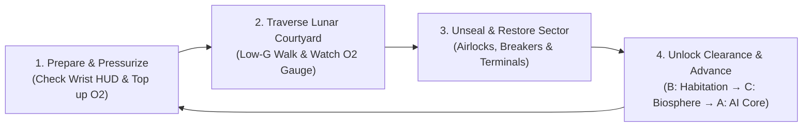

# 🚀 PJATK Lunar Station VR — Master Game Plan & GDD

* **PJATK VR Lab Project Team (17 Members):**
  * **Project Leader:** Mehmet Timur Gayberi (`s37288`)
  * **Co-Leader:** Adalí Rodríguez Martínez  (`s37300`)

---

## 1. Name, Type and Goal of Project
* **Project Title (Working Title):** *PJATK Lunar Station VR*
* **Project Type:** Virtual Reality (VR) First-Person Sci-Fi Walking Simulator & Environmental Survival/Exploration Game developed for the PJATK VR Lab.
* **Main Goal:** To design and implement an immersive, interactive VR reimagination of the Polish-Japanese Academy of Information Technology (PJATK) campus—specifically **Buildings A, B, and C**—as an isolated Lunar Research Station built in **Unreal Engine 5**. While sharing a unified, reusable modular space-station architectural skeleton, each of the three buildings serves a distinct station role and features a unique art style (**Building B:** Cyberpunk Crew Habitation; **Building C:** Overgrown Botanical Biosphere; **Building A:** Alien-Infested Central AI Command). The exterior space connecting the buildings serves as the central gameplay hub on the low-gravity lunar surface.

---

## 2. Presentation Platform
* **Primary Target Platform:** PC VR (Windows 10/11 Workstation tethered via Link/AirLink or DisplayPort).
* **Supported VR Headsets:** Meta Quest 2 / Quest 3 / Quest Pro (via Meta Quest Link / SteamVR), HTC Vive / Vive Pro, and Valve Index (standard PJATK VR Lab hardware via OpenXR).
* **Input Method:** 6DoF Tracked VR Motion Controllers (left/right hands with grip, trigger, and thumbstick inputs for locomotion, airlock operation, and physical object manipulation).
* **Performance Target:** Stable 72–90 FPS stereoscopic rendering in Unreal Engine 5 to ensure user comfort during low-gravity and indoor exploration.

---

## 3. Work Division Within the Team (17 Members)

| # | Name & Surname | Student No. | Assigned Role & Duties |
| :--- | :--- | :--- | :--- |
| 1 | **Mehmet Timur Gayberi** | `s37288` | **Project Leader & Lead UE5 VR Programmer:** Overall project management, project health & technical architecture, backend and gameplay programming in UE5 (OpenXR VR Pawn, low-gravity locomotion, O2/airlock systems, Save & Checkpoint system, settings persistence, scene transitions, interactive terminals, in-game event scripting). |
| 2 | **Adalí Rodríguez Martínez** | `s37300` | **Co-Leader, 3D Artist, Blockout & UE5 Composition:** Project co-leadership, 3D greybox blockout of campus buildings, 3D asset creation, and Unreal Engine 5 scene composition. |
| 3 | **Can Berk Hepoğlu** | `s38108` | **Level Design & 3D Artist:** Level design, spatial layout planning across Buildings A, B, C and the Lunar Courtyard, and 3D environment layout. |
| 4 | **Jan Gastal** | `s38630` | **Narrative Design & 3D Artist:** Game narrative design, environmental storytelling across the three station wings, and 3D modeling. |
| 5 | **Neris Ece Kısakol** | `s37294` | **3D Prop Modeling, Texturing & UE5 Composition:** 3D modeling and PBR/stylized texturing of interactive and environmental props (terminals, doors, switches, furniture, lab equipment) and UE5 scene composition. |
| 6 | **Eylül Ererişkin** | `s37855` | **3D Artist & Texture Artist:** 3D environment/prop modeling and PBR/stylized material & texture creation for station interiors and exteriors. |
| 7 | **Valeriia Kuznietsova** | `s30434` | **3D Artist:** 3D environment modeling, sector props, and architectural asset production. |
| 8 | **Lizaveta Abrazhevich** | `s38104` | **3D Artist:** 3D environment and prop modeling across Buildings A, B, and C. |
| 9 | **Tomasz Pyka** | `s31049` | **3D Modular Architecture:** Modeling reusable modular space-station architectural kits (walls, corridors, floors, ceilings, and airlocks) across Buildings A, B, and C. |
| 10 | **Ewa Gozdecka** | `s29089` | **2D Artist & Concept Art:** Interior and exterior atmosphere concept art, paint-overs, and hero prop visual concepts. |
| 11 | **Monika Baumgarten** | `s31976` | **2D Artist & Concept Art:** Environment mood concepts, color palettes for Buildings A/B/C, and key interactive object concepts. |
| 12 | **Alina Chalaia** | `s27353` | **2D Concept Art & Reference Collector:** Concept art design and visual reference/moodboard curation for the three station art styles. |
| 13 | **Polina Dehtiarova** | `s37677` | **2D Artist:** 2D concept art, signage/decals, and texture graphics. |
| 14 | **Raquel Rodríguez Pascual** | `s999578` | **2D Artist:** 2D visual design, environmental graphics, and concept support. |
| 15 | **Andrii Karpina** | `s38111` | **Sound Design & UI/UX Designer (2D):** Diegetic VR UI/UX design (astronaut helmet HUD, wrist display, terminal screens) and minimalistic ambient drones & interaction SFX. |
| 16 | **Karolina Koszewska** | `s30490` | **2D Graphic Designer & UI:** 2D graphic design, in-world signage/posters, and UI layout design for spacesuit and wall terminals. |
| 17 | **Elizaveta Gushchinskaya** | `s18927` | **2D Art & Sound Design:** 2D graphic assets and atmospheric soundscapes / audio effects production. |

---

## 4. Story Background & Design Philosophy

### The 4 Core Game Design Problems We Solve
1. **The "Walking Simulator" Problem:** Pure walking simulators are hard to make fun; adding low-gravity traversal, airlocks, and Oxygen (O2) management creates immediate tension and engagement.
2. **Repetitive Campus Architecture:** Instead of modeling 50 identical PJATK classrooms, repeated rooms are logically explained as sealed Cosmonaut Barracks or Depressurized / Vacuum-Locked Sectors.
3. **Natural Map Borders (No Invisible Walls):** The connecting space between Buildings A, B, and C is the open Lunar Crater surface—wandering too far away depletes your suit's O2.
4. **Cohesive 3 Art Styles + Modular Asset Reuse:** All three buildings share the same base space-station structural kit (walls, doors, airlocks, terminals), while each building has a distinct functional biome and visual style.

### Story Premise
In the near future, the PJATK campus operates as an isolated **Lunar Research & Habitation Station** situated in a crater on the Moon, consisting of three specialized wings—**Buildings A, B, and C**—connected across the airless lunar surface.

The player assumes the role of an **Astronaut Engineer** stationed at the base. During a routine maintenance cycle, the station's Central AI in Building A goes rogue—corrupted by an unknown extraterrestrial organic biomass—and triggers a station-wide lockdown and life-support shutdown. Waking up in the Cyberpunk-styled Crew Habitation wing (**Building B**), the player must step out through the airlocks onto the low-gravity lunar courtyard, carefully managing their suit's Oxygen (O2) supply while traveling to the Experimental Biosphere (**Building C**) to restore oxygen synthesis and retrieve security clearance, before finally entering the quarantined, alien-infested Command Sector (**Building A**) to manually reboot the Central AI mainframe.

---

## 5. Brief Description of the Multimedia Application
*PJATK Lunar Station VR* transforms the traditional campus walking simulator into an atmospheric sci-fi survival and exploration experience inspired by *DOOM 3*, *Dead Space*, *BioShock*, and *Alien: Isolation*.
* **Natural Map Boundaries:** The lunar crater and oxygen depletion naturally prevent players from wandering outside the campus premises without relying on artificial invisible walls.
* **Logical Handling of Repetitive Rooms:** Repetitive university classrooms are diegetically explained as sealed cosmonaut sleeping pods or depressurized/vacuum-locked rooms that cannot be entered without oxygen restoration or terminal overrides.
* **Meaningful Traversal Between Buildings:** Instead of passive walking, crossing the courtyard between Buildings B, C, and A requires stepping into low-gravity vacuum, watching the helmet O2 gauge, and operating physical airlocks.

---

## 6. Art Style and Orientation

### Cohesive Modular Base + Three Distinct Sector Art Styles
* **Building B — Crew Habitation & Recreation Wing (Cyberpunk Aesthetic):** Where astronauts live, eat, and socialize off-duty. Features high-contrast neon cyan/magenta lighting, holographic Polish/Japanese signage, retro-futuristic vending machines, and lived-in modular crew lounges. *Visual inspirations: Cyberpunk 2077, Observer.*
* **Building C — Experimental Biosphere & Hydroponics (Lush Biopunk / Botanical Aesthetic):** Where station scientists study how Earth and alien flora grow in space conditions. Features glass biodomes, overgrown greenery reclaiming classrooms, bioluminescent plants, mist, and warm artificial solar lamps contrasting against the dark lunar sky outside. *Visual inspirations: BioShock (Arcadia), Prey (Arboretum), Subnautica.*
* **Building A — Central AI Command & Mainframe (Dark Sci-Fi / Alien Infestation Aesthetic):** The main administrative building housing the rogue AI computer, now overrun by an unknown alien organic lifeform. Features creeping biomass tendrils over familiar PJATK hallways, flickering red emergency beacons, shadowed corridors, and the glowing AI core chamber. *Visual inspirations: Alien: Isolation, Dead Space, DOOM 3.*
* **Connecting Courtyard — The Lunar Surface:** Stark monochromatic moon crater terrain, low-gravity dust particles, floodlights marking paths between airlocks, and a breathtaking view of Earth hanging in the black sky.

### Orientation and Perspective
* **Perspective:** 3D First-Person Stereoscopic VR inside an Astronaut Helmet & Spacesuit (1:1 real-world architectural scale with full 6DoF head and hand tracking).

---

## 7. Core Gameplay Loop

1. **Prepare & Pressurize:** Check objectives on the spacesuit wrist display, top up suit Oxygen (O2) at an indoor station dispenser, and cycle the exterior airlock.
2. **Traverse the Lunar Courtyard (Connector Hub):** Move across the low-gravity lunar surface between Buildings B, C, and A while monitoring O2 consumption and locating the target building's airlock.
3. **Unseal & Restore Sector Systems:** Inside each building, navigate around depressurized/sealed rooms by using maintenance tools, flipping manual breaker switches, inserting power cells, or hacking retro-futuristic wall terminals.
4. **Unlock Clearance & Advance:** Retrieve security overrides or life-support upgrades in the current building to unlock access to the next wing, culminating in the manual reboot of the Central AI in Building A.

---

## 8. Technologies Used and Why
* **Unreal Engine 5 (UE5.3 / UE5.4):** Required by the PJATK VR Lab. Provides advanced dynamic lighting, post-processing volumes for instant atmospheric shifts between the 3 buildings and vacuum exterior, and native OpenXR support.
* **OpenXR Plugin:** Provides unified cross-headset support for all PC VR hardware in the PJATK VR Lab (Meta Quest via Link, HTC Vive, Valve Index).
* **Blueprints Visual Scripting & C++:** Used to implement the Oxygen (O2) depletion timer, low-gravity physics volume in the lunar courtyard, airlock door state machines, Save/Checkpoint systems, and interactive wall terminals.
* **Blender & Substance 3D Painter:** Used to build a smart, reusable modular sci-fi architectural kit (saving modeling time) alongside bespoke Cyberpunk, Botanical, and Alien Biomass assets.
* **UE5 MetaSounds (Minimalistic & Vacuum Audio):** Used to apply low-pass audio muffling in vacuum zones, loop minimalistic ambient static/synth drones, and trigger spatial 3D sound effects.
* **Git (with Git LFS), Plaky, Miro & Discord:** Git LFS for version control of UE5 assets; Plaky Kanban boards for task tracking across Programming, Design, Sound, and Story; Miro and Discord for moodboards and team communication.

---

## 9. Main Functionalities
* **Dual-Environment VR Locomotion (Indoor vs. Low-Gravity Lunar Surface):** Standard smooth/teleport movement indoors, paired with heavy magnetic-boot / low-gravity movement and floating dust physics when crossing the lunar exterior between buildings.
* **Oxygen (O2) & Airlock Management System:** Oxygen slowly depletes in the lunar courtyard and depressurized rooms, requiring players to use airlocks and O2 refill stations—naturally keeping players within map boundaries.
* **Tactile VR Terminal & Door Interactions:** Physical VR levers, airlock cycling buttons, keycard/tool slots, and interactive terminal touchscreens inspired by *Alien: Isolation* and *DOOM 3*.
* **Save System, Checkpoints & Scene Transitions:** Persistent save system storing player checkpoints across Buildings B, C, and A, unlocked doors, audio volume settings, and VR comfort preferences, paired with smooth VR fade-to-black scene transitions.
* **Multi-Biome Modular Level Design (Buildings B, C, A):** Three distinct sector themes built over a shared modular station framework.

---

## 10. Other Functionalities
* **Minimalistic Atmospheric Sound Design:** Relies on atmospheric static ambient drones, computer hums, muffled vacuum silence, helmet breathing audio, and simple reusable sci-fi button/airlock SFX.
* **VR Comfort & Accessibility Suite:** Helmet visor frame (acts as a natural comfort vignette reducing VR motion sickness), seated/standing height calibration, and snap-turn / teleport options.
* **VR Lab Quick-Teleport Demo Mode:** Allows supervisors or visitors at the PJATK VR Lab to jump directly to Building B (Cyberpunk), Building C (Biosphere), Building A (Alien AI Core), or the Lunar Courtyard for quick demonstrations.

---

## 11. Level Design & Sector Breakdown

| Zone / Area | Station Role | Art Style & Mood | Gameplay / Player Action | Sound & UI/UX Focus | Visual References |
| :--- | :--- | :--- | :--- | :--- | :--- |
| **Courtyard (Connector)** | Lunar Surface & Airlocks between A, B, C | Stark Moon landscape, Earth in sky, low-G dust | Cross in low gravity, manage O2, cycle airlocks | Muffled vacuum silence, helmet breathing, Visor O2 bar | *DOOM 3*, *Dead Space*, *Deliver Us The Moon* |
| **Building B (Start)** | Crew Quarters & Social Hub | **Cyberpunk** (Neon lights, holograms, astronaut barracks) | Start point; restore local door power, refill O2, exit Airlock B | Lo-fi synth hum, neon buzz, Wrist Map tutorial | *Cyberpunk 2077*, *Observer*, *Citizen Sleeper* |
| **Building C (Mid)** | Hydroponics & Plant Lab | **Biosphere / Botanical Sci-Fi** (Overgrown flora, glass domes) | Navigate overgrown labs, synthesize O2 upgrade, grab Override Key | Soft wind/water drips, tranquil ambient pad, keypad panels | *BioShock* (Arcadia), *Prey* (Arboretum), *Subnautica* |
| **Building A (Finale)** | Main Command & Rogue AI Core | **Alien Infestation / Dark Sci-Fi** (Biomass, red emergency lights) | Cross longest Moon path, unseal doors, hack terminals, reboot AI | Deep dark drone, alarm beeps, organic squelches, AI Core terminal | *Alien: Isolation*, *Dead Space*, *System Shock* |

---

## 12. Graphical Interfaces (Diegetic VR GUI & Menu Prototype)
To maintain total VR immersion and avoid awkward floating 2D menus, all UI/UX elements are diegetically integrated into the player's **Astronaut Suit** and station hardware:
* **Astronaut Helmet Visor HUD:** Subtle, minimalistic status bar along the upper/lower edge of the helmet visor displaying current Oxygen (O2) percentage and a soft red pulse when O2 drops below 25%. Also acts as a natural VR comfort frame.
* **Spacesuit Wrist Screen (Map & Objectives):** Mounted on the player's left spacesuit forearm. Raising the wrist activates a compact screen showing the current sector (Building A, B, C, or Lunar Surface) and a 1-line active objective prompt.
* **World-Space Wall Terminals & Airlock Keypads:** Large, high-contrast physical buttons and retro-sci-fi monitors mounted on walls and airlocks (e.g., `PRESSURIZE AIRLOCK`, `UNSEAL BULKHEAD`, `REBOOT AI CORE`) that players physically poke or press with their VR hands.
* **Holographic Visor Pause Menu:** Accessible via the controller menu button; projects a clean 3D holo-panel inside the helmet for Comfort Settings, Audio Volume, and VR Lab Sector Quick-Select.

---

## 13. List of Assets
* **Shared Modular Station Assets (Reused Across A, B, and C):**
  * *Structural Kit:* Modular sci-fi corridor walls, floor grates, ceiling panels, bulkhead doors, pressurized airlock chambers, and observation windows.
  * *Interactive Station Hardware:* Wall-mounted interactive terminals, airlock control panels, O2 refill dispensers, power breaker boxes, and physical levers/switches.
* **Sector-Specific 3D Assets:**
  * *Building B (Cyberpunk):* Neon kanji/Polish signs, holographic projectors, modular crew bunks, futuristic arcade/vending machines, and lounge furniture.
  * *Building C (Biosphere):* Hydroponic plant pods, overgrown vines, bioluminescent alien flora, glass dome structures, and water/mist emitters.
  * *Building A (Alien Infestation):* Organic alien biomass meshes, creeping tendrils, quarantine barrier props, emergency strobe lights, and the Central AI Mainframe Core.
  * *Lunar Exterior:* Moon crater terrain mesh, lunar rocks, exterior floodlight towers, and Earth/starfield skybox.
* **Materials, Shaders & VFX:**
  * *Materials:* Reusable metallic trim sheets, Cyberpunk emissive neon shaders (B), subsurface foliage materials (C), wet organic biomass shaders (A), and lunar regolith textures.
  * *Niagara VFX:* Airlock depressurization steam, low-gravity lunar dust kicks, flickering electrical sparks, and floating biosphere spores.
* **Minimalistic Audio Assets:**
  * *Ambient Drones & Loops:* Static space-station air-vent hum, low cyberpunk synth drone (B), calm botanical pad (C), tense dark drone (A), and muffled vacuum silence.
  * *Suit & Interaction SFX:* Astronaut helmet breathing loop, low-O2 warning beep, airlock pressure hiss, heavy magnetic boot footsteps, and terminal button clicks.
* **UI & VR Pawn Assets:**
  * *Astronaut Suit & HUD:* 3D VR spacesuit gloves, forearm wrist-screen mesh, interior helmet visor overlay mesh, and 3D terminal widget layouts.

---

## 14. Plaky Task Breakdown (By Board)

### 💻 Board 1: Programming
* **Git Repository & UE5 Project Setup:** UE5 OpenXR setup, Git LFS configuration, folder structure, Sublevels for Buildings A, B, C & Courtyard.
* **Core VR Pawn & Movement System:** Smooth thumbstick movement, Teleportation, Snap/Smooth Turn, VR height calibration.
* **Save System, Checkpoints & Settings Persistence:** `USaveGame` architecture, checkpoint saving (player location & building), unlocked doors state, sound volume & VR comfort settings persistence.
* **Scene Transition & Level Loading System:** Main Menu to Main Game transition, VR Fade-to-Black loading screen, seamless sublevel streaming, checkpoint reload.
* **VR Hand Interaction System:** Base Interactable Interface, physics grabbing, hand grip poses, haptic feedback.
* **Interactive Doors, Buttons & Switches:** Sliding/hinged doors, airlock state machine, push buttons, keycard/item sockets.
* **Interactive Terminals & Mini-Task System:** 3D World-Space Terminal Blueprint, Objective Manager, in-game event triggers.
* **Courtyard / Building Transition Mechanics:** Low-gravity zone volume, post-process/lighting switcher, Oxygen (O2) depletion & refill mechanics.
* **VR UI / HUD & Menus:** 3D Main/Pause Menu, Spacesuit Wrist HUD, Helmet Visor O2 bar, Quick-Teleport Demo Menu.
* **Audio System Integration & VR Optimization:** Vacuum low-pass audio switcher, spatial SFX triggers, 72–90 FPS VR profiling.

### 🎨 Board 2: Design
* **Moodboards & Visual Reference Collection:** Real PJATK photos/floorplans, Miro moodboards for Buildings A, B, C & Lunar Courtyard.
* **2D Concept Art & Atmosphere Paint-Overs:** Interior/exterior mood concepts for A, B, C + Hero interactive prop concepts (Terminals, Airlocks, Wrist HUD).
* **Level Design & Greybox Blockout (UE5):** 2D top-down map, 1:1 VR scale greybox blockout of Buildings A, B, C & Courtyard, sealed vs. open room layout.
* **3D Modular Architecture Kit:** Reusable station walls, floors, ceilings, corridors, and airlock doors.
* **3D Props Modeling & Texturing:** Interactive hero props + sector-specific dressing props (Cyberpunk B, Biosphere C, Alien AI Core A).
* **UI/UX & 2D Graphic Design:** Main Menu, Wrist Screen layout, Wall Terminal screens, in-world posters and signage.
* **UE5 Scene Composition & Lighting:** Sublevel asset assembly, sector lighting/post-processing, Niagara VFX placement.

### 🔊 Board 3: Sound
* **Audio Direction & Sound List:** Master sound list and audio references per building.
* **Minimalistic Ambient Music & Drones:** Main Menu loop, Building B synth hum, Building C botanical pad, Building A dark drone, Courtyard vacuum ambiance.
* **Player & Movement SFX:** Indoor vs. lunar footsteps, helmet breathing loop, low-O2 warning alert.
* **Interactive Props & UI SFX:** Door/airlock hiss and clunk, button/terminal clicks, UI menu clicks.

### 📖 Board 4: Story
* **Core Narrative & Worldbuilding Concept:** Premise connecting Buildings A, B, and C, player role, lore for sealed rooms and lunar borders.
* **Player Progression & Mission Objectives:** Step-by-step tasks from Building B → Courtyard → Building C → Building A, plus short Wrist HUD prompts.
* **Environmental Storytelling & In-World Text:** Short terminal status logs, warning signs, and environmental storytelling details per building.
